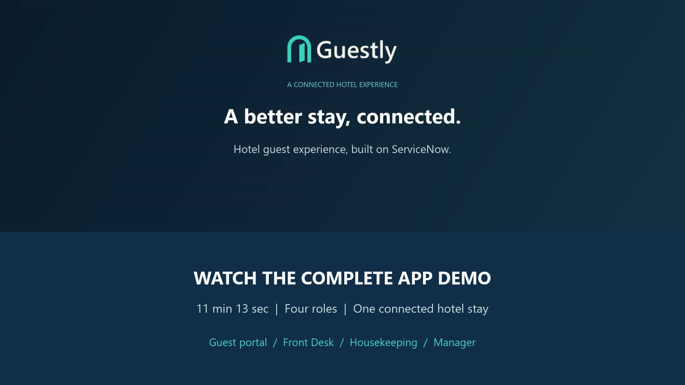
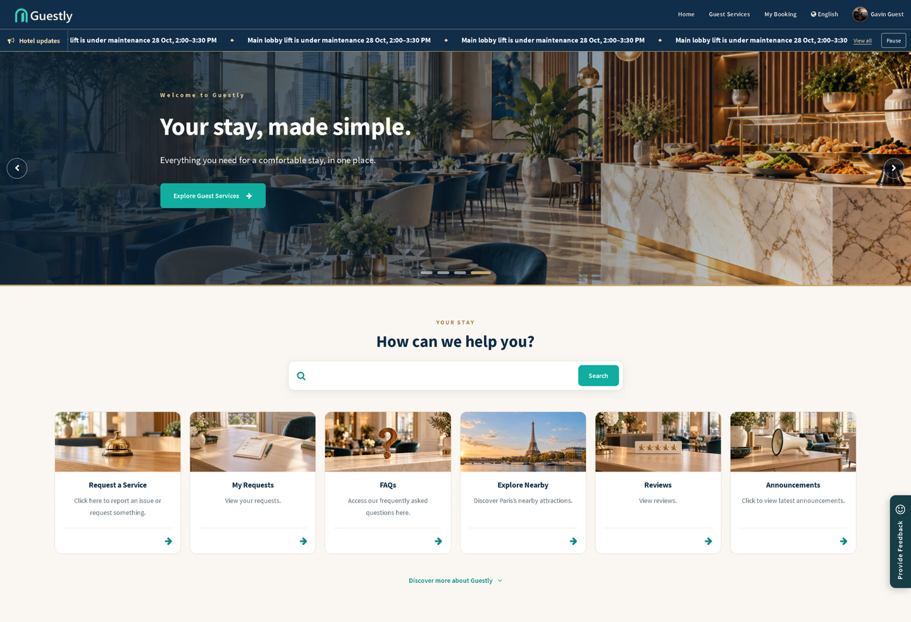
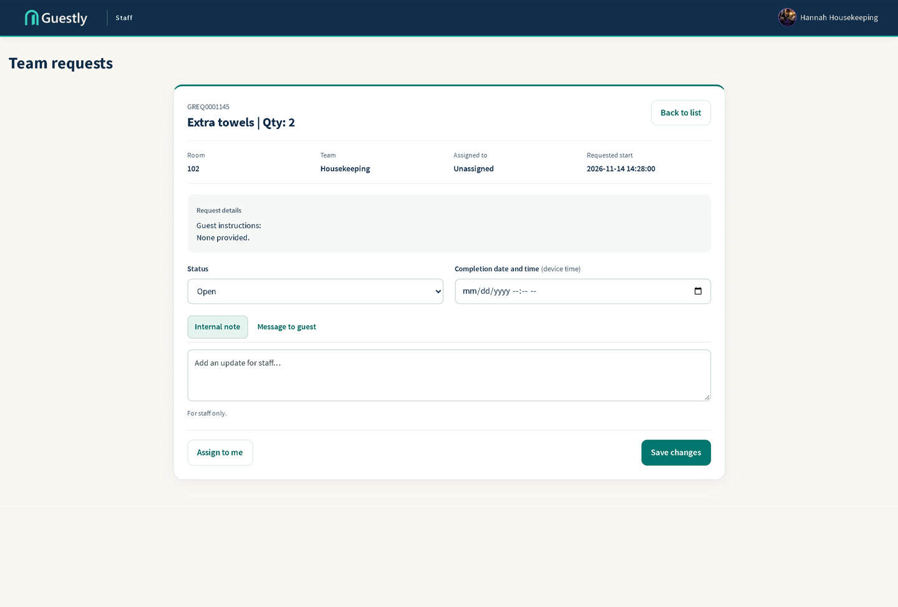
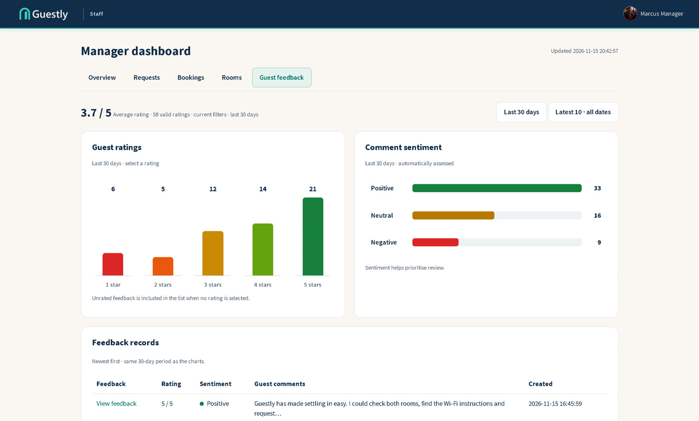
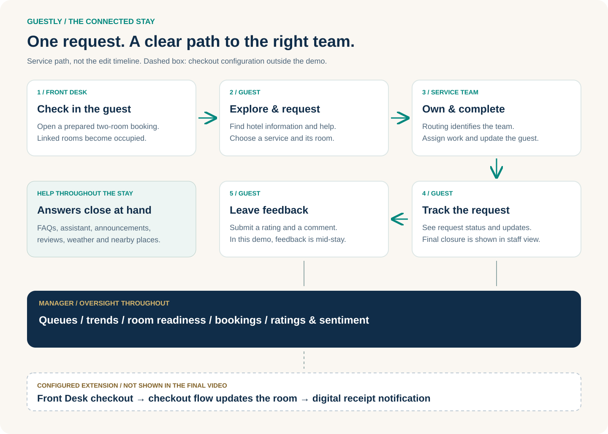

# Guestly

**Hotel service, connected from the guest's room to the right team.**

Final team project for **RiseUp with ServiceNow**. A visual portfolio case study; application source and an installation package are not included.

## Problem

A guest calls reception about a room issue. Then calls again. When requests sit across calls, messages and handwritten notes, staff can't easily tell who owns the work or what the guest has already been told. Managers may hear about the delay only when a complaint arrives.

## Solution

We built Guestly on ServiceNow to connect 4 roles: guest, Front Desk, service team and manager. Guests request help for their rooms and track progress. Staff get a focused queue, while managers can follow the operation across departments.

Hotel information is close at hand too: bookings, FAQs, announcements, reviews and nearby places with weather and directions.

## Result

In our demo, Felix checks Gavin into a prepared booking for rooms **109 and 110**. Gavin submits 2 room-specific requests; Hannah in Housekeeping takes ownership and completes them. Marcus reviews operations and guest sentiment.

That's the working process we've demonstrated with sample data. We haven't measured production savings or deployed Guestly to a live hotel.

## Watch the demo

**[Open or download the video](assets/demo/Guestly-Complete-App-Demo.mp4)** ·

Jump to the chapter guide: [Front Desk · 00:25](docs/demo.md#front-desk--0025) · [Guest · 02:29](docs/demo.md#guest-portal--0229) · [Housekeeping · 06:43](docs/demo.md#housekeeping--0643) · [Manager · 08:23](docs/demo.md#manager--0823).

The recording shows check-in for an existing booking. Booking creation and checkout aren't shown. [Full guide and local player](docs/demo.md).

## See the experience

**A guest can find help without calling reception.**

**The team gets room context and tools to take ownership.** Internal notes and guest messages have separate inputs.

**Managers can review guest ratings alongside comment sentiment.** Chart selections filter the relevant feedback records in the demo.

Previews are resized or cropped for readability. Click them to see the untouched original captures. [All 20 screenshots](docs/gallery.md).

## How the stay connects

## Technical implementation

| Technology / configuration | How we used it |
| --- | --- |
| Scoped app and custom tables | Bookings, rooms, guest requests and feedback. |
| Service Portal widgets | Guest portal and role-specific staff views using HTML, CSS, AngularJS and server-side JavaScript. |
| Widget client controllers | Room selection, service basket, filters, pagination, record editing and chart drilldowns. |
| Client Script | `Show Only Most Recent Work Note` controls the work-note display. |
| Business Rules | `Validate Booking Dates`, `Force pending on Missing Info`, `Guestly - Populate booking and room`. |
| Flow Designer: stays | `Booking - Check-in Room` and `Booking - Check-out Room` update room state. |
| Flow Designer: requests | `Intelligent Category Routing Flow` and `Resolution Timestamp Auto-Stamping`. |
| Flow Designer: sentiment | `Guestly Feedback Sentiment Analysis V2` supplies stored comment classifications. |
| UI Policies | Required room, assignment, cleanliness, completion and check-in/out information; out-of-order room restrictions. |
| Notifications | Booking/reservation confirmation, pre-arrival welcome, request updates/closure and checkout receipt configuration. |
| Roles and ACLs | Guest, reception, agent and manager access, supported by server-side record and field checks. |
| Weather | Open-Meteo through server-side `RESTMessageV2`. |
| Maps | Embedded Google My Maps, directions links and official attraction websites. |
| Knowledge and AI assistance | Guestly FAQs and configured Now Assist / Virtual Agent in the original lab. |
| Reporting widgets | Team queues, request trends, room readiness, bookings, ratings and stored sentiment. |

For the design decisions behind the screens, see [access, fulfilment and reporting](docs/technical-design.md). [Configuration evidence](docs/configuration-evidence.md) distinguishes the earlier export from later staff portal work.

## My contribution

I'm **Abul Mohsin**. I owned the guest and staff portals, their UI and portal logic. I also contributed to Flow Designer automation, the AI assistant, ACLs and the table structure.

Guestly was a team effort for RiseUp with ServiceNow. The wider application and automation were developed collaboratively; I don't claim sole authorship. [Credits and reuse](NOTICE.md).

## Evidence and project status

| Evidence | Where to look |
| --- | --- |
| Guest experience: 8 views | [Guest gallery](docs/guest.md) |
| Reception: 4 views | [Front Desk gallery](docs/front-desk.md) |
| Team fulfilment: 3 views | [Housekeeping gallery](docs/housekeeping.md) |
| Operational oversight: 5 views | [Manager gallery](docs/manager.md) |
| Demonstrated behaviour and checks still needed | [Validation summary](docs/validation.md) |
| Capture and sample-data limitations | [Capture notes](docs/capture-notes.md) |

The technical inventory combines an earlier export with later staff work and the recorded demo. It isn't a fresh audit. Some captures retain incomplete sample records, and the available evidence doesn't establish production readiness, successful inbox delivery or access-denial behaviour on the current instance.
