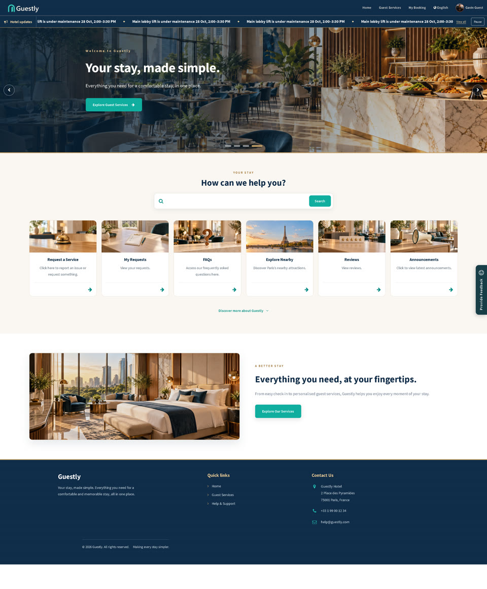
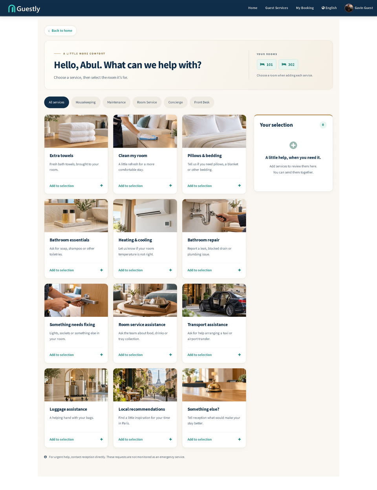
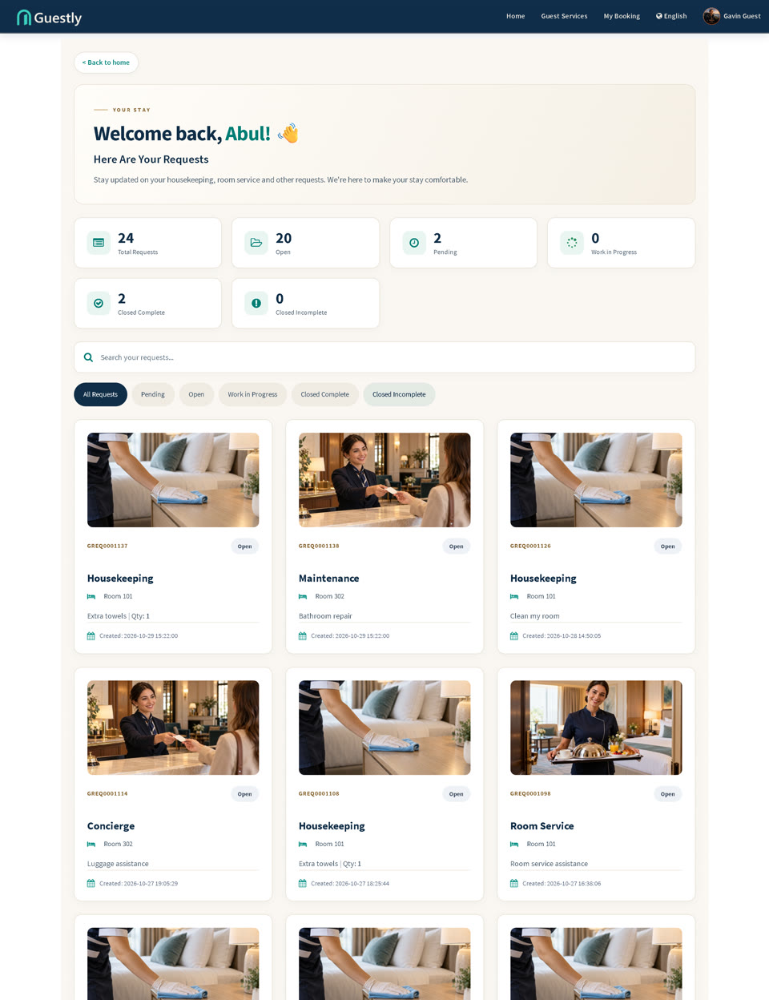
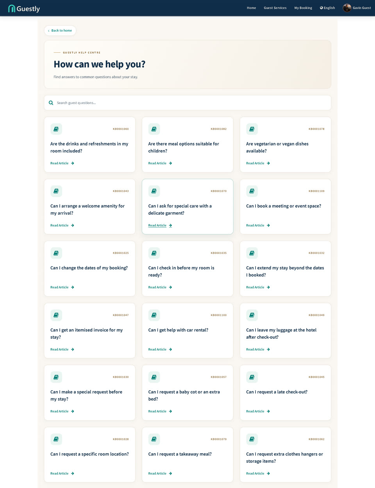
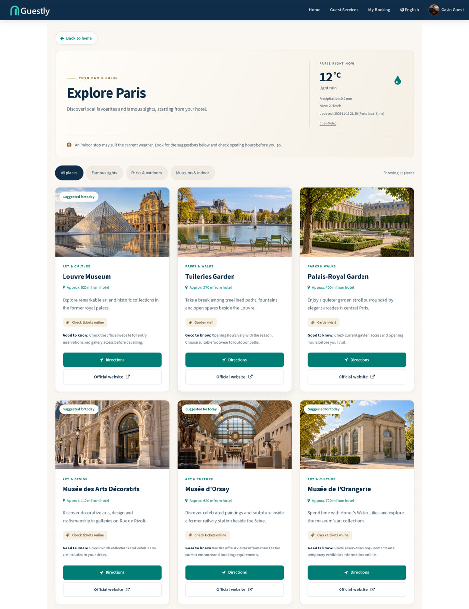
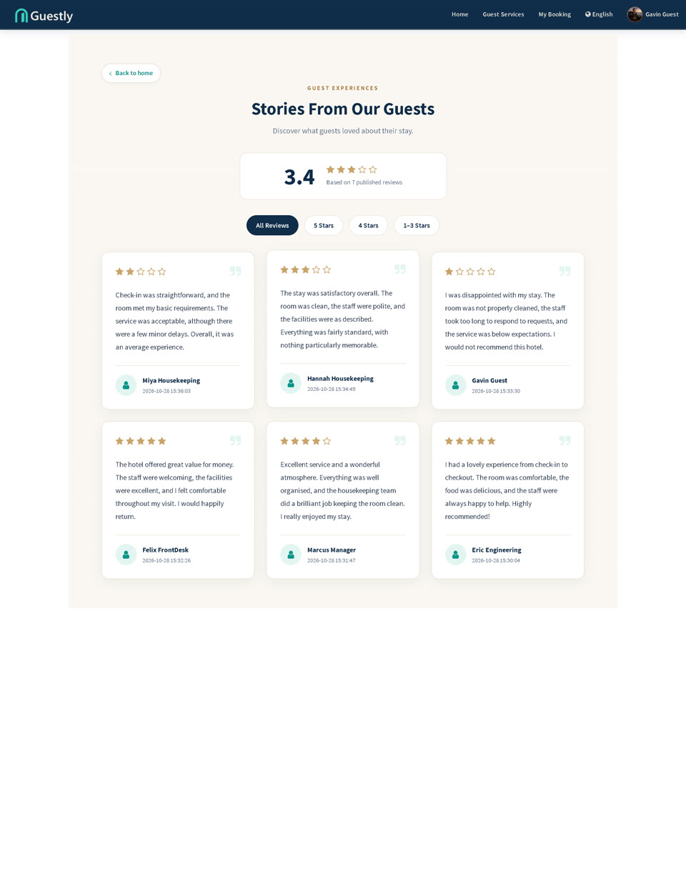
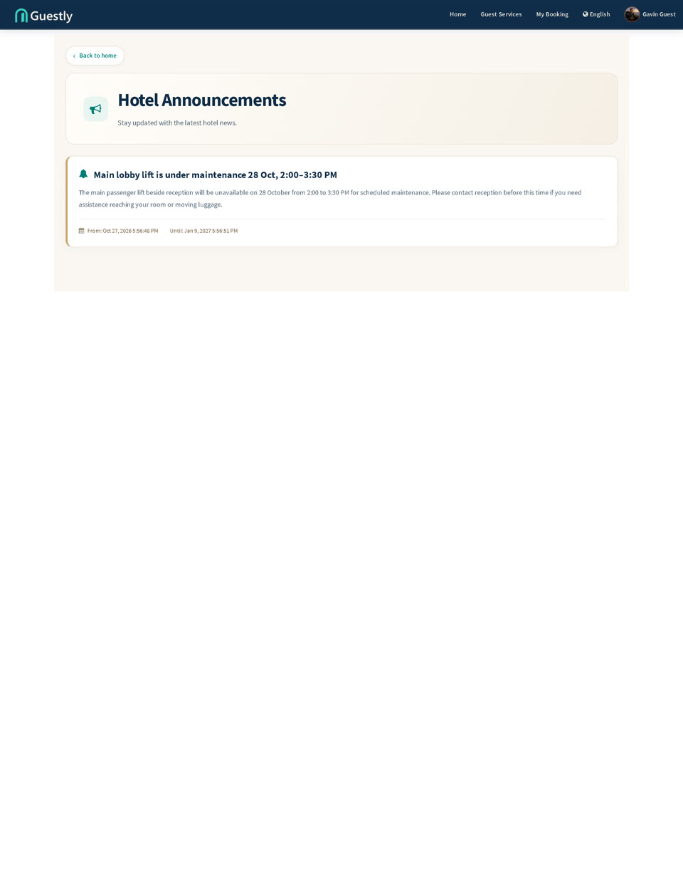
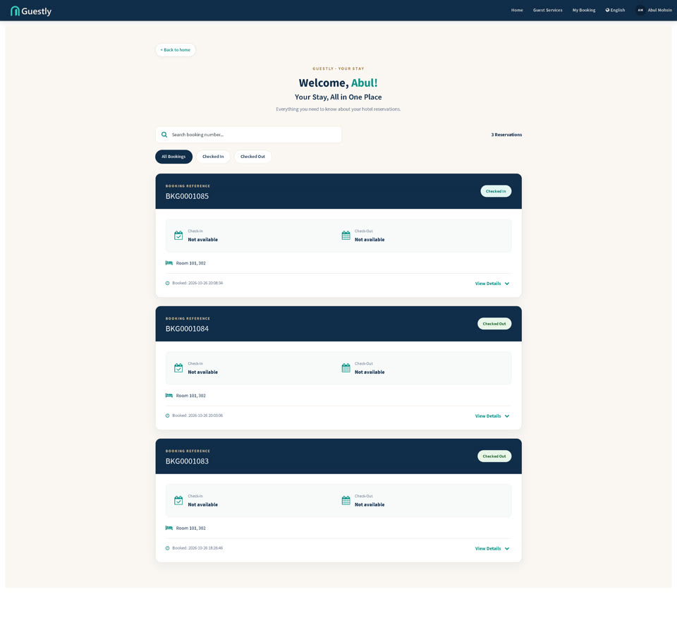

# Guest portal

[All galleries](gallery.md) · [Demo](demo.md) · [Capture notes](capture-notes.md)

Click a preview for the original image. Each caption identifies the feature and any capture limit.

## Guest home

**Highlight:** A single starting point for services, requests, hotel information and feedback.

## Request a service

**Highlight:** Service categories, room selection and a basket for sending several services together.

## My requests

**Highlight:** Status totals, search and room-specific request cards. This supplied capture ends partway through the list.

## Help centre

**Highlight:** Searchable hotel knowledge articles. The screenshot shows the captured article list.

## Explore nearby

**Highlight:** Paris weather, suggested places, distances, directions and official websites. Six of the twelve listed places are visible.

## Guest reviews

**Highlight:** Published reviews with an average rating and rating filters.

## Hotel announcements

**Highlight:** Hotel notices with their publication windows.

## My booking

**Highlight:** Booking history, stay status and multiple rooms on a reservation. Dates are unavailable in the captured records.

