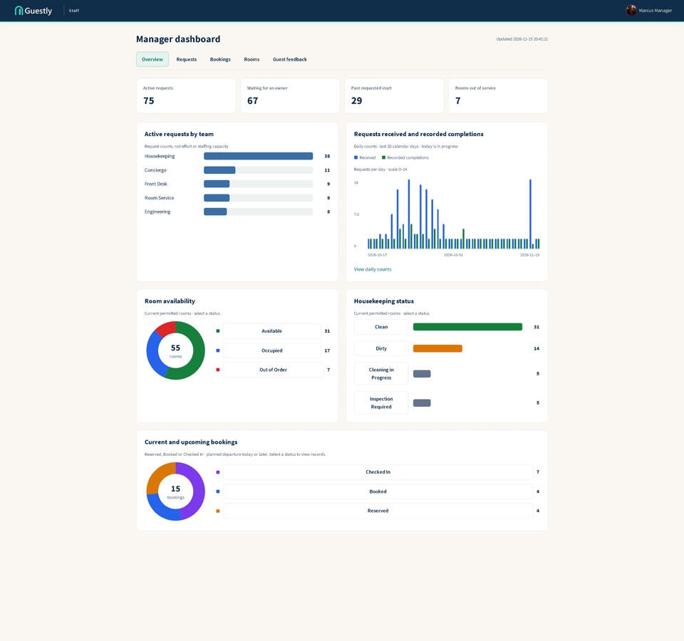
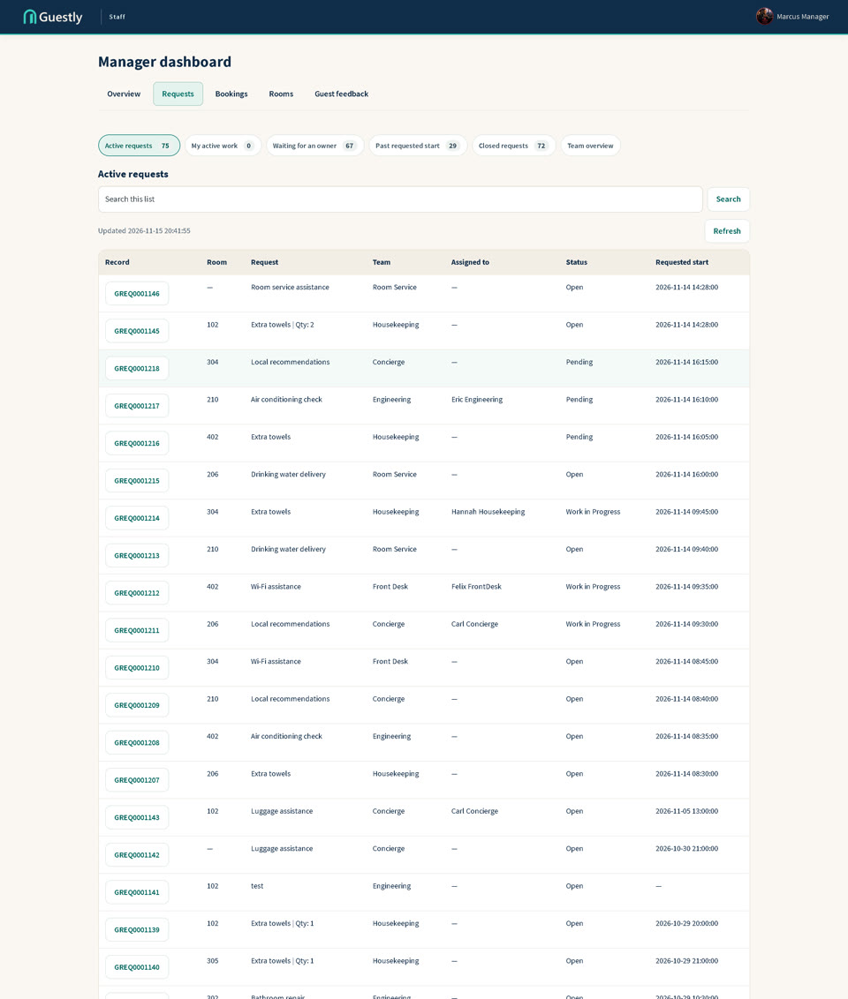
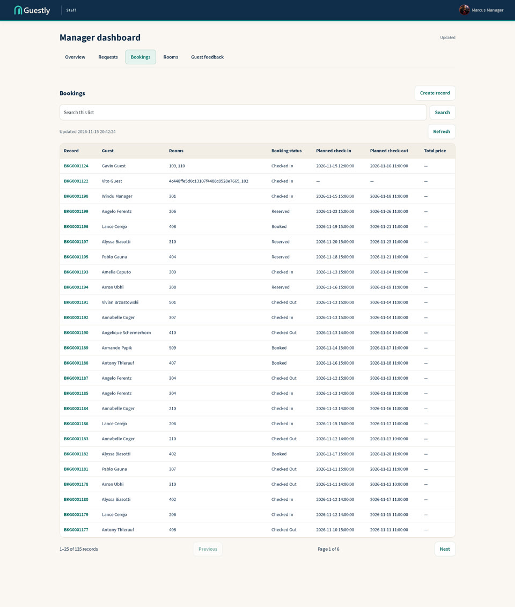
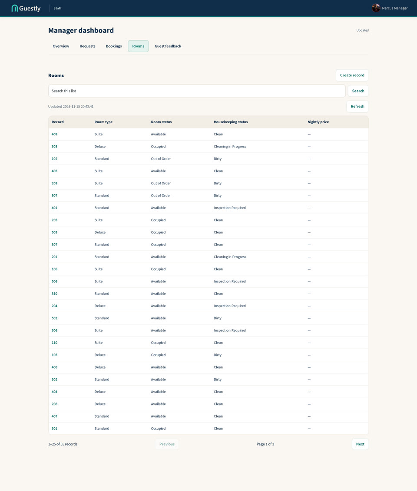
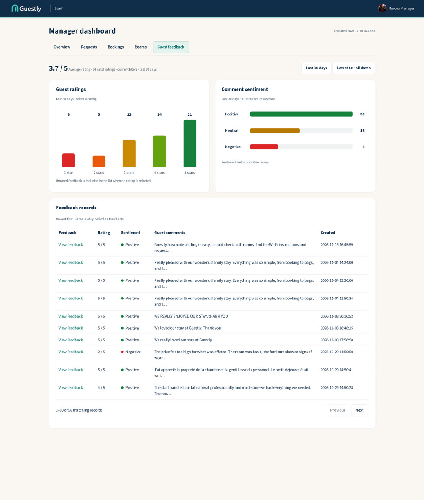

# Manager dashboard

[All galleries](gallery.md) · [Demo](demo.md) · [Capture notes](capture-notes.md)

Click a preview for the original image. Each caption identifies the feature and any capture limit.

## Manager overview

**Highlight:** Operational totals, team queues, request trends, room availability, housekeeping and upcoming stays.

## All-team request queue

**Highlight:** Cross-team visibility with ownership and request status. The list continues below the capture.

## Bookings

**Highlight:** Searchable bookings with guests, rooms, planned dates and pagination.

## Rooms

**Highlight:** Room type, availability and housekeeping status in a paginated table.

## Guest feedback and sentiment

**Highlight:** Ratings beside positive, neutral and negative comment sentiment, with the feedback records below.

